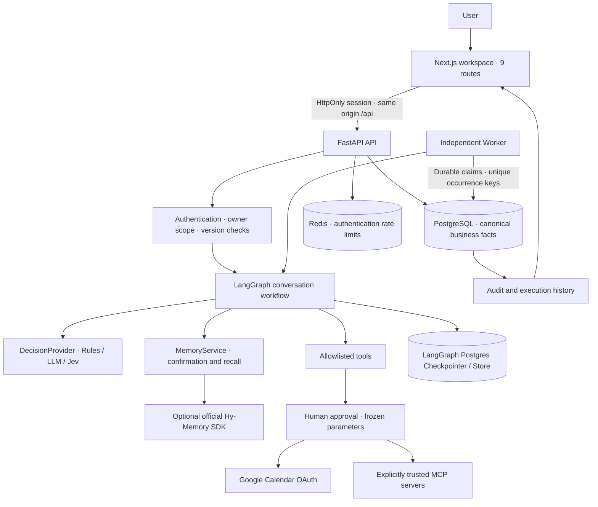

# PersonalOS architecture

PersonalOS separates conversational state, consented personal facts, and durable work. An LLM proposes actions; authenticated services enforce their scope.

## State boundaries

- `records` reuses a consistent tenant/lifecycle schema for tasks, memory, events, approvals, connections, briefings and audit. Typed input models and kind checks preserve each resource's contract.
- `automations` stores a schedule. `executions` stores an occurrence, a unique run key, lease and claim token. Advancing the schedule and materializing the occurrence happen in one transaction.
- `messages` holds the visible transcript. Official LangGraph PostgreSQL checkpointer tables hold resumable graph state. Consented memory is a separate fact source and is never inferred to be approved merely because it appeared in a chat.
- Model and OAuth secrets are encrypted on the server. Responses and exports exclude credentials. HTTPS, encrypted backups and access control remain deployment responsibilities.
- Chat, automation and briefings use owned HTTP clients with redirects disabled. User-selected model endpoints are validated again at invocation; administrator-configured local endpoints retain explicit trust. DNS lookup is bounded and connection probes have total deadlines. This does not pin resolved addresses: production still needs outbound network controls against DNS rebinding.
- A settings draft retains its reviewed version until successful save or explicit reload. Same-origin authentication changes invalidate other tabs' cached identities and records before showing the new workspace; independent local deployment databases remain separate.

## Scheduling and failure semantics

Scheduler workers select due rows using `FOR UPDATE SKIP LOCKED`; they create one occurrence and coalesce missed intervals. Another transaction claims queued work and stores a fencing token. A late worker cannot overwrite a recovered execution. An expired lease or timeout becomes `outcome_unknown`: the system refuses blind retry because a remote service may have already committed an effect.

Local read/validation errors, rejected approval, provider failure and unknown outcome are distinct. Human approval is bound to the stored parameters and version; a model route or Jev classification grants no permissions. MCP calls are denied until both host allowlisting and explicit trust/tool permission are present.

## Index and IO design

All user-facing reads constrain `owner_id` and resource kind and exclude tombstones. Lists have bounded pagination. Primary-key lookups, `(owner_id, kind, deleted_at, created_at)`, event interval and scheduler status/time indexes support the main access paths. Services assemble related records without SQL JOINs. Tiny development fixtures may make PostgreSQL choose a sequential scan; this is not evidence of production index performance. The verification report distinguishes index presence and query plans from a production load benchmark.

## Privacy and external acceptance

Deleting a canonical fact prevents future recall from that fact source. The approved deletion clears the local Store entry, removes copied memory payloads from legacy audit records and resets resumable graph checkpoints so recalled facts cannot linger there. Visible conversation history is retained explicitly; old user messages and external provider history require separate controls. The memory API records purge state. Hy-Memory's SDK deletion receipt is insufficient to prove every derived index/cache is absent; see [integration evidence](integrations.md). Credentialed Google/DeepSeek/Hy/Jev/MCP acceptance must be run against the user's chosen services before production use.
